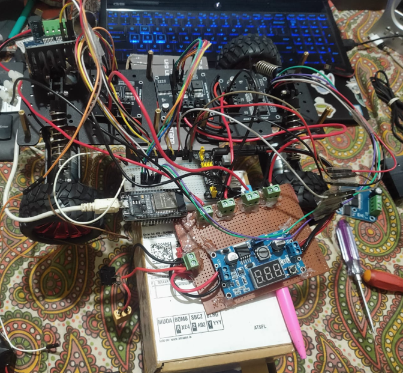
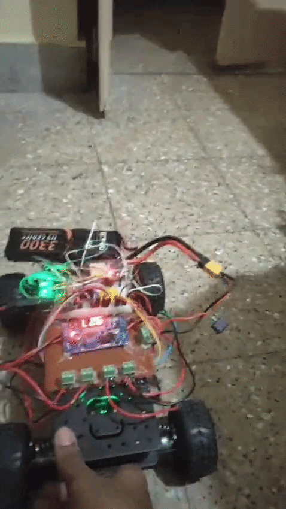

# PID Based Stationary Heading Correction Rover

An ESP32-based four-motor differential-drive rover that uses a **BNO055 IMU** and a **PID heading controller** to detect yaw deviations and command corrective motor speeds. Built with **ESP-IDF**, **FreeRTOS**, I²C sensor communication, and LEDC PWM motor control.


## My Story
This is an image of how my study table looked while building this thing. It was an amazing experience working on this tiny kid and it taught me to push myself beyond my limits and capabilities. So if you are stuck somewhere while working on your project dont give up, I almost blew up the power distribution board and the motor driver at 4am after working on it for like 9hrs. 
So yeaa after all that kaboom it still ended up meeting my checklist and I was able to finish things on time. 
ALL THE BESHTT!!!


  


> **Current behavior:** The checked-in firmware sets `base_speed = 0`, so it is configured for **stationary, on-the-spot heading correction**. The motor mixing algorithm also supports heading correction **while driving**, but forward-motion scheduling is not enabled in the active code.

## 🎥 Demonstration

### PID-Based Heading Correction

The rover detects heading deviations using IMU feedback and applies differential motor control to restore its target heading.




## How it works

1. `app_main()` initializes the BNO055 and PWM motor channels, captures the initial target yaw, and launches the PID and motor tasks.
2. The BNO055 task reads yaw over I²C approximately every 20 ms and publishes `current_yaw`.
3. The PID task computes the shortest signed angular difference between `target_yaw` and `current_yaw` and publishes `control_output`.
4. The motor task mixes forward speed with the steering correction, sets opposite-side motor commands, and repeats approximately every 20 ms.

```text
BNO055 (yaw via I²C)
         |
         v
   current_yaw -----------+
                           |
   target_yaw ----------> angular error
                           |
                           v
                        PID task
                           |
                      control_output
                           |
                           v
                    Motor mixing task <--- base_speed
                      /           \
                     v             v
                 left motors   right motors
                    PWM            PWM
```

### Heading control

The angular error is normalized to the range `[-180°, +180°]`:

```c
error = normalize_angle(target_yaw - current_yaw);
```

Current source-code gains (`main/pid.c`): **`Kp = 8`, `Ki = 0`, `Kd = 1`**. The implementation uses a fixed `dt = 0.02 s` and a nominal **50 Hz** task cadence. With `Ki = 0`, its current behavior is effectively **PD control**; an integral accumulator exists but does not contribute to the output.

The motor task computes:

```c
left  = base_speed - correction;
right = base_speed + correction;
```

- **Stationary correction (`base_speed = 0`):** left and right sides receive opposite-signed commands, creating a turn-in-place response to a yaw error.
- **Moving correction (`base_speed > 0`):** differential wheel speeds steer the rover toward the target heading while it moves, provided the correction does not overpower the requested forward speed.

The firmware suppresses corrections with magnitude below `5`, scales corrections by `0.2` when the heading error is below `2°`, and clamps the calculated left/right commands to `[-255, 255]`. It also multiplies the command to the first right motor by `2` as a motor-specific compensation; **that multiplication happens after clamping** and should be bounded before relying on it in hardware.

## Hardware and interfaces

| Component / interface | Role | Source configuration |
| --- | --- | --- |
| ESP32 | Main controller running FreeRTOS tasks | `idf.py set-target esp32` |
| BNO055 IMU | Yaw/heading estimate | I²C address `0x28` |
| I²C bus | ESP32-to-IMU communication | SDA GPIO 21, SCL GPIO 22, 100 kHz |
| Four DC motors and suitable motor drivers | Differential-drive propulsion / correction | Two motors per side |
| ESP32 LEDC peripheral | PWM commands to motor-driver inputs | 18 kHz, 8-bit duty resolution |

**Motor-driver connections defined in `main/motor.c`:**

| Motor | Forward PWM GPIO | Reverse PWM GPIO | LEDC channels (forward / reverse) |
| --- | ---: | ---: | --- |
| Right motor 1 | 25 | 26 | 0 / 1 |
| Right motor 2 | 32 | 33 | 2 / 3 |
| Left motor 1 | 27 | 14 | 4 / 5 |
| Left motor 2 | 18 | 19 | 6 / 7 |

These GPIOs are PWM control signals, **not direct motor-power outputs**. Use motor drivers and a properly rated external motor supply; connect grounds as required by your driver design.

## Repository structure

```text
pid_car/
├── CMakeLists.txt           # Top-level ESP-IDF project definition
├── sdkconfig                # ESP-IDF build and target configuration
├── README.md                # Project documentation
└── main/
    ├── CMakeLists.txt       # Registers the application C source files
    ├── main.c               # Initialization and FreeRTOS task startup
    ├── imu.c                # BNO055 I²C setup, mode selection, yaw reading
    ├── imu.h                # IMU initialization, yaw task and angle helpers
    ├── pid.c                # Heading PID calculation at nominal 50 Hz
    ├── pid.h                # PID task declaration
    ├── motor.c              # LEDC configuration, direction, motor mixing and output
    ├── motor.h              # Motor structure and motor control declarations
    ├── control.c            # Shared target/current yaw and control output variables
    └── control.h            # External declarations of shared control variables
```

### File-by-file guide

| File | What it does |
| --- | --- |
| `main/main.c` | Attempts BNO055 initialization, configures motors, initializes `target_yaw` from `current_yaw`, and starts `pid_task` and `motor_task`. |
| `main/imu.c` | Sets up the ESP-IDF I²C master; probes the BNO055; configures normal power, degree units, and **IMU mode**; starts a yaw-reading task after the expected system status; combines yaw register bytes, scales by 1/16, and normalizes the angle. |
| `main/imu.h` | Declares `bno_init()`, `bno_euler_task()`, and `normalize_angle()`. |
| `main/pid.c` | Calculates wrapped heading error, integral and derivative terms, then shares the PID output with the motor task; prints yaw/error/output diagnostics. |
| `main/pid.h` | Declares the FreeRTOS PID task. |
| `main/motor.c` | Defines the four motor pin/channel mappings, initializes 18 kHz LEDC PWM, controls forward/reverse direction, mixes `base_speed` with PID correction, clamps commands, and updates motor outputs. Contains **commented-out** movement experiments such as forward ramps and angle-scanning routines; these are not active. |
| `main/motor.h` | Defines `motor_t` (PWM channels and GPIOs) and declares motor initialization, motor task, speed control, and `base_speed`. |
| `main/control.c` | Defines shared `volatile` variables: `current_yaw`, `target_yaw`, `control_output`, and `heading_error`. An older distance-to-speed `control_update()` implementation is commented out. |
| `main/control.h` | Exposes shared control variables across translation units. |
| `main/CMakeLists.txt` | Registers all five application `.c` files with ESP-IDF. |
| `CMakeLists.txt` | Loads ESP-IDF's CMake build system and declares the `pid_car` project. |
| `sdkconfig` | Stores configuration choices generated/managed by ESP-IDF. |

The generated `build/` directory and local virtual environments are not needed in version control.

## Building and flashing

Install and activate a compatible **Espressif ESP-IDF toolchain** first. In an ESP-IDF-enabled terminal:

```powershell
cd D:\pid_car
idf.py set-target esp32
idf.py build
idf.py -p COMx flash monitor
```

Replace `COMx` with the actual serial port. The code uses ESP-IDF's newer `driver/i2c_master.h` API, so build with an ESP-IDF version that provides it. Hardware connections, motor-driver specifications, and the board's serial port need to match your setup.

## Current implementation status and limitations

- **Stationary yaw correction is active in code:** `base_speed` starts at zero, and the stop-on-zero check in `motor_task()` is commented out, allowing opposite-direction motor commands.
- **Moving heading correction is supported by the motor mixing, but not enabled as an autonomous driving sequence:** the `go_forward()` routine and related sequencing logic in `motor.c` are commented out; no active code increases `base_speed` above zero.
- **Initial setpoint timing:** `target_yaw = current_yaw` is executed just after IMU initialization, but before confirming a fresh yaw sample has been read. A valid sensor sample should be awaited before latching the initial heading.
- **IMU mode:** the BNO055 is configured in IMU fusion mode (`0x08`), which does not use its magnetometer for an absolute compass reference; yaw can drift over time.
- **PWM safety:** `right_motors[0]` receives `right * 2` after the common clamp, potentially exceeding the 8-bit maximum of 255.
- **Control limitations:** no motor encoder feedback or measured wheel-speed control, no integral windup protection, and a fixed 20 ms interval rather than measuring elapsed time. Shared `volatile` variables are used without synchronization.
- **Validation:** this README documents source-code behavior; it does not claim measured tracking accuracy, tested maximum speed, or demonstrated moving-rover results.

## Possible next steps

1. Enable and test a controlled nonzero `base_speed`, including acceleration/deceleration and safe stopping.
2. Saturate **every final PWM command** to its legal range and document any per-motor compensation.
3. Wait for a valid yaw update before setting the target heading; verify the heading-correction sign on real hardware.
4. Log target yaw, actual yaw, motor duties, and tracking error to assess controller performance under motion.
5. Add encoder feedback or speed estimation if consistent ground-speed control is needed.


